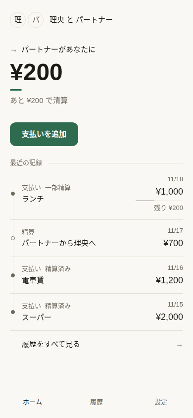
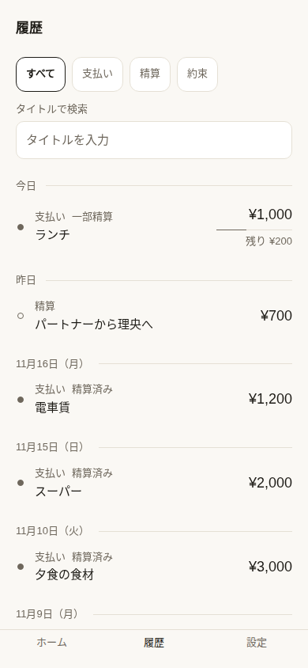
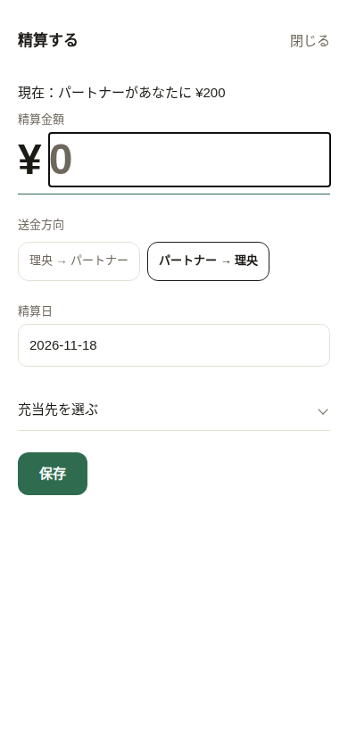
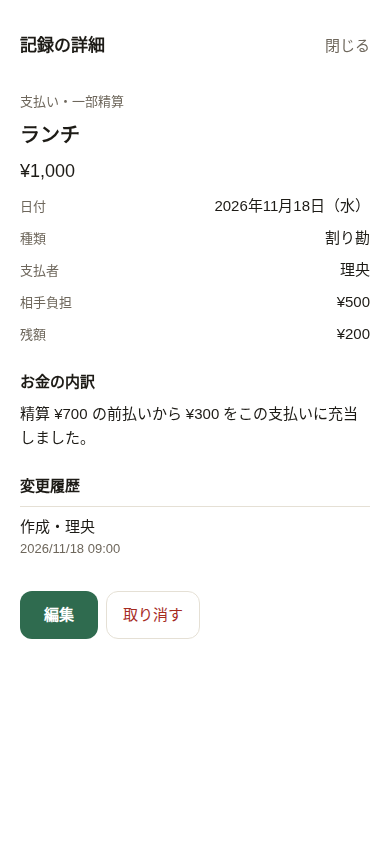
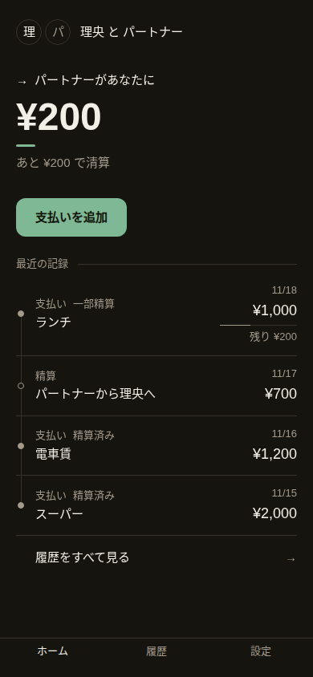

# Couple Ledger

2人の割り勘と精算を記録するアプリです。「どちらが・いくら払ったか」を数秒で記録できて、ホーム画面には「どちらがどちらに・いくら払えば清算できるか」が常に1つの数字で表示されます。

貸し借りの言い合いにならないよう、金額の言葉は中立に統一し、取り消しや変更の履歴もすべて残る設計にしています。

**Web版（動作します）**: https://couple-ledger-web-alpha.vercel.app
スマートフォンのブラウザで開いて「ホーム画面に追加」すると、アプリのように使えます。

## スクリーンショット

| ホーム（残高） | 支払い入力 | 履歴 |
| --- | --- | --- |
|  |  |  |

| 精算入力 | 記録の詳細・変更履歴 | ホーム（ダーク） |
| --- | --- | --- |
|  |  |  |

## できること

- **ペア連携**: 招待コードで2人を連携。コードはハッシュ化して保存し、平文はデータベースに残しません
- **支払いの記録**: 金額を入れるだけでも記録可能。半額・金額指定などの負担方法に対応し、相手の負担額はその場で表示されます
- **精算の記録**: 実際に渡したお金を記録。どの支払いに充てるか（充当先）の指定もできます
- **残高の自動計算**: 残高はアプリ側では計算せず、精算エンジンがすべての記録から決定論的に再計算します。前払い（払いすぎ）も正しく扱います
- **履歴と変更履歴**: 支払いと精算を1本のタイムラインで表示。編集・取り消し・復活と、その影響プレビューを確認できます
- **ペアの解散と復活**: 解散したペアは閲覧のみ可能。復活申請を承認すると、同じペアのまま再開できます

## 技術スタック

| 領域 | 技術 |
| --- | --- |
| アプリ | Expo / React Native / TypeScript（Expo Router） |
| API | Cloudflare Workers / Hono / TypeScript |
| DB・認証 | Supabase（PostgreSQL / Auth） |
| 精算エンジン | TypeScript の純粋関数パッケージ（フレームワーク非依存） |
| インフラ | Vercel（Web版） / Cloudflare Hyperdrive（DB接続） |

## リポジトリ構成

```text
app/       Expo アプリ（画面・状態管理・APIクライアント）
api/       Hono API（書き込みはすべてここを経由し、1コマンド=1トランザクション）
engine/    精算エンジン（残高の再計算ルールの単一実装）
supabase/  DBスキーマのマイグレーション
docs/      要件定義・DB設計・スクリーンショット
```

## 設計のポイント

- **残高の「正」は1か所だけ**: 支払い・精算の原簿から精算エンジンが投影（充当・相殺・前払い）を再計算し、DBのビュー `pair_balances` を唯一の参照点にしています。クライアントは残高を自前で計算しません
- **冪等性**: すべての書き込みAPIは `Idempotency-Key` が必須で、再送しても二重に記録されません
- **競合の検出**: 編集はバージョンと台帳リビジョンで検証し、古い画面からの保存は 409 で弾きます
- **監査ログ**: すべての変更を `audit_logs` に追記します
- **アクセス制御**: PostgreSQL の RLS で、自分のペアのデータ以外は読み書きできません

精算ルールの仕様（充当・相殺・前払いの処理順序と計算例）は `docs/` の要件定義・DB設計にまとめています。

## テスト

- 精算エンジン: 単体テスト 13件（計算例の段階検証、プロパティテスト1,000ケース含む）
- API: 統合テスト 24件（書き込み・冪等性・ペアライフサイクル・RLS検証含む）
- DBスキーマ: 実PostgreSQL互換環境でDDL適用と整合性チェック（全チェック0件）を確認
- 本番環境で、登録→ペア連携→支払い→精算の一連の流れ（E2E）を確認済みです

```bash
# 精算エンジン
cd engine && npm test

# API
cd api && npm test

# アプリ
cd app && npm test
```

## ローカルで動かす

```bash
# アプリ（フィクスチャデータでそのまま動きます）
cd app
npm install
npx expo start --web

# API（テストはインメモリのPostgreSQL互換環境で完結します）
cd api
npm install
npm test
```

本番相当の構成（Supabase Auth・実APIへの接続）にする場合は、`app/.env.example` の環境変数を設定し、`EXPO_PUBLIC_DATA_SOURCE=api` に切り替えます。

## 開発の進め方

要件定義（機能要件95件・受け入れテスト35件）とDB設計を先に固め、設計契約（画面の色・余白・タイポグラフィのルール）を決めてから実装に入りました。実装はAIコーディングエージェント（Codex）を使い、担当は「要件をブリーフに落とす・設計を決める・テストと実レンダリングで検証する」側に集中しています。各段階で型チェック・テスト・画面の目視確認を通してから次に進めています。

## 現在の状態

- Web版を公開し、実際に2人で使い始めています
- 未実装: リアルタイム同期、退会・匿名化（スキーマの拡張が必要なため今後の課題）
